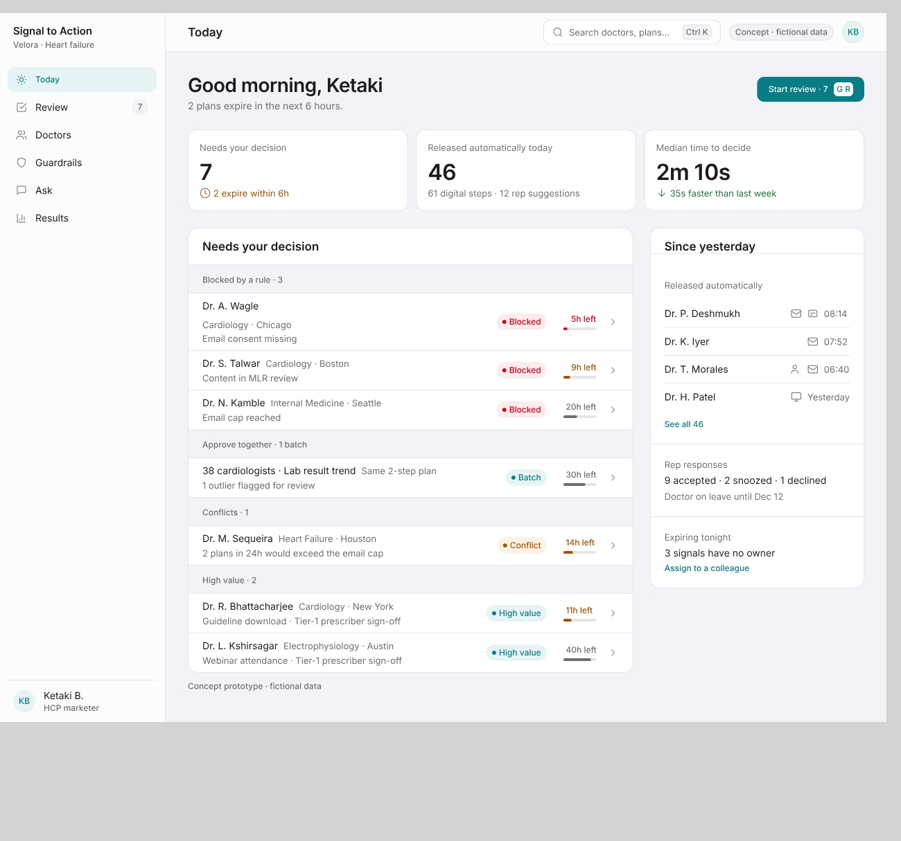

# Signal to Action

A concept prototype for the screens where a pharma brand team decides what happens after a doctor-level signal: what goes out automatically, what needs a person, and what the sales rep sees.

> **Independent concept.** Built from public information for a Product Engineer (UI) application. Velora, every doctor, rep, NPI and number is fictional. Not affiliated with or endorsed by any company.



## The idea in one line

Plans that pass every guardrail are released automatically; people review only the exceptions, and those few decisions are made fast, safe and explainable.

## What's in it

| Screen | What it shows |
|---|---|
| **Today** | Exceptions grouped by reason, what went out automatically, rep responses, signals about to expire with no owner |
| **Review** | The exception queue with filters and `J`/`K` keyboard navigation |
| **Batch review** | One decision for 38 similar plans, with the outlier pulled out |
| **Plan detail** | Decision first; 48-hour window timeline; editable steps (timing, approved content, add, redraft with a note); live rules with one-click fixes; impact as a range with "How we know"; reject with a reason |
| **Released plan** | A send queue you can cancel until each send time, step statuses, activity log |
| **Doctor profile** | Field and digital touches on one timeline, contact pressure across all plans |
| **Guardrails** | WHEN → THEN → GUARDRAILS → RELEASE rule builder with a 30-day replay, version history and approval |
| **Ask** | Answers with drivers, confidence and method; changes open in Guardrails |
| **Results** | Lift vs matched comparison doctors, by signal type |
| **Rep's CRM view** | The suggestion a rep receives (safe-to-say reason), with Accept / Snooze / Not relevant flowing back to the plan |

Demo controls live in the avatar menu (top right): simulate a CRM outage, show an empty queue, reset the demo, switch light/dark. State is kept in memory, so a page reload resets the demo.

**Keyboard:** `Ctrl K` search · `G` then `T/R/D/G/A/S` to switch screens · `J`/`K` move in the queue · `A` release · `R` redraft · `X` reject.

## Stack

React 19 · TypeScript · Vite · Tailwind CSS v4 · shadcn/ui (Radix) · cmdk · Sonner · Recharts · Lucide · Zustand · React Router (hash routing, so it works on any static host).

## Run it

Requires Node.js 20+.

```bash
npm install
npm run dev      # http://localhost:5173
npm run build    # production build in dist/
```

## Deploy

- **Netlify:** connect the repo (settings come from `netlify.toml`), or run `npm run build` and drag the `dist` folder onto app.netlify.com/drop.
- **Vercel:** import the repo; framework preset "Vite", output `dist`.
- **GitHub Pages:** push to `main`, then in the repo go to Settings → Pages → Source: "GitHub Actions". The included workflow builds and publishes it.

## Project layout

```
src/
  pages/          one file per screen
  components/     shell (sidebar, top bar), command menu, queue list, previews, shared bits
  components/ui/  shadcn/ui components
  lib/rules.ts    rules engine (MLR content, consent, email cap across plans, rep capacity, conflicts),
                  impact ranges and the guardrails replay model
  store/          app state and actions (Zustand)
  data/           fictional seed data and insights
docs/
  designs/        the Stitch designs this build follows
  stitch-prompts.md
public/docs/      spec, usability test plan and one-pager linked from the About page
```

## Process

1. Researched the company and category from public sources.
2. Built a first HTML prototype, then critiqued its logic: per-plan approval doesn't scale, marketers shouldn't direct reps, single-number estimates are falsely precise, and "undo" after sending is impossible.
3. Wrote a design brief and generated screens in Stitch (`docs/stitch-prompts.md`, `docs/designs/`).
4. Built this React version with AI coding tools, matching the designs and adding the working logic.
